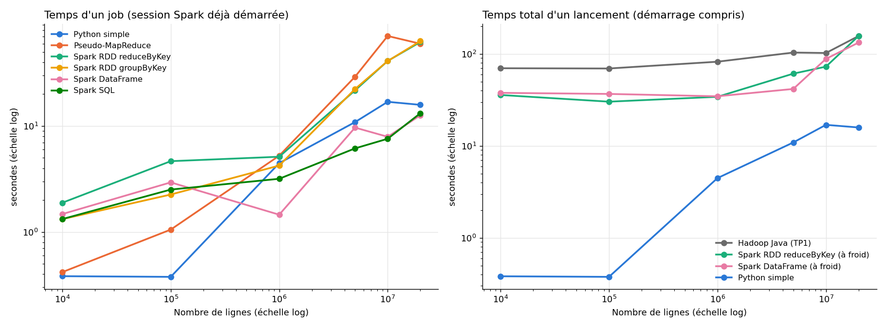

# TP1 — Partie 2 : comptage de mots avec Apache Spark (PySpark)

Cours *Fondements et Application de Big Data*. On reprend le comptage de mots de
[la partie 1](../Partie1_Python_MapReduce_Hadoop) (Python simple, pseudo-MapReduce, Hadoop MapReduce),
mais avec **Apache Spark depuis PySpark**.

**Le rendu est le notebook [`notebook_spark_wordcount.ipynb`](notebook_spark_wordcount.ipynb)** : explications, code, tests,
comparaisons et conclusion.

## Quatre implémentations Spark (`src/spark_wordcount.py`)

| Méthode | Code | Remarque |
|---|---|---|
| RDD + `reduceByKey` | `textFile → flatMap → map(mot, 1) → reduceByKey(+)` | agrégation locale avant le shuffle (≈ combiner Hadoop) |
| RDD + `groupByKey` | `… → groupByKey → mapValues(sum)` | toutes les paires traversent le shuffle (≈ pseudo-MapReduce) |
| DataFrame | `read.text → explode(split) → groupBy("mot").count()` | optimiseur Catalyst, exécution dans la JVM sans worker Python |
| Spark SQL | `SELECT mot, COUNT(*) … GROUP BY mot` | même plan physique que le DataFrame |

## Contenu

```
Dockerfile                    Python 3.12 + OpenJDK 17 + PySpark 4.2.0 + Jupyter
src/spark_wordcount.py        les 4 implémentations + création de la SparkSession (exécutable en ligne de commande)
src/benchmark_spark.py        temps « chaud », temps « à froid », scalabilité 1→8 cœurs ; vérifie chaque résultat
src/generer_fichier.py        générateur du TP1 (N lignes d'un mot, dupliquées m fois)
src/wordcount_simple.py       méthodes 1 et 2 du TP1, pour la comparaison
src/wordcount_mapreduce.py
tests/test_spark_wordcount.py tests pytest
results/                      mesures (CSV) et graphiques ; results/tp1/ = mesures du TP1
```

## Utilisation

PySpark tourne dans un conteneur Linux : sous Windows natif, Spark lance un nouvel interpréteur Python par tâche,
ce qui coûtait 40 à 60 s pour un simple job de 8 tâches sur ce poste (voir le notebook).

```bash
docker build -t spark-wordcount:4.2.0 .
docker run --rm -v "%cd%:/work" spark-wordcount:4.2.0 python -m pytest -v tests
docker run --rm -v "%cd%:/work" spark-wordcount:4.2.0 python src/benchmark_spark.py
docker run --rm -p 8888:8888 -v "%cd%:/work" spark-wordcount:4.2.0 jupyter lab --ip=0.0.0.0 --allow-root --no-browser
```

Un comptage seul :

```bash
docker run --rm -v "%cd%:/work" spark-wordcount:4.2.0 bash -c "python src/generer_fichier.py --m 100 --out /tmp/d && python src/spark_wordcount.py /tmp/d/mots_N10000_m100.txt --methode dataframe"
```

## Résultats

Temps en secondes, N = 10 000 lignes dupliquées m fois. Spark : session `local[*]` déjà démarrée (médiane de 3) ;
« à froid » = nouveau processus, démarrage de la JVM compris. Python et Spark mesurés dans le même conteneur ; Hadoop : TP1.
Chaque méthode donne exactement le même résultat, à chaque taille.

| lignes | Python simple | Pseudo-MR | Spark RDD reduceByKey | Spark RDD groupByKey | Spark DataFrame | Spark SQL | Spark DataFrame à froid | Hadoop Java (TP1) |
|---:|---:|---:|---:|---:|---:|---:|---:|---:|
| 10 000 | 0.38 | 0.42 | 1.88 | 1.32 | **1.47** | **1.32** | 37.7 | 69.8 |
| 100 000 | 0.38 | 1.05 | 4.66 | 2.25 | **2.94** | **2.51** | 36.7 | 69.4 |
| 1 000 000 | 4.46 | 5.24 | 5.13 | 4.23 | **1.45** | **3.18** | 34.6 | 82.3 |
| 5 000 000 | 10.89 | 29.19 | 21.70 | 22.36 | **9.66** | **6.15** | 41.6 | 103.5 |
| 10 000 000 | 16.93 | 70.85 | 41.16 | 41.08 | **7.91** | **7.58** | 88.3 | 102.3 |
| 20 000 000 | 15.85 | 59.86 | 62.10 | 63.39 | **12.62** | **13.20** | 132.9 | 156.6 |



Scalabilité (5 M de lignes) :

| cœurs | RDD reduceByKey (s) | accélération | DataFrame (s) | accélération |
|---:|---:|---:|---:|---:|
| 1 | 103.3 | ×1.0 | 19.5 | ×1.0 |
| 2 | 49.4 | ×2.1 | 14.5 | ×1.3 |
| 4 | 29.5 | ×3.5 | 12.3 | ×1.6 |
| 8 | 21.3 | ×4.8 | 7.5 | ×2.6 |

> Mesures faites sur un poste chargé (CPU hôte à 95–100 % : visioconférence, autres conteneurs) : valeurs absolues à ± 30 % environ,
> mais tendances et classement nets.

**Conclusion courte :** sur de petits fichiers, Python reste le plus rapide (un job Spark coûte au moins ≈ 1 à 5 s).
Dès le million de lignes, **Spark DataFrame / SQL dépasse Python** (jusqu'à ≈ 2× plus rapide) grâce au parallélisme et à Catalyst,
alors que **l'API RDD avec des lambdas Python est 2 à 4× plus lente** que Python à cause de la sérialisation JVM ↔ Python.
Par rapport à Hadoop, Spark démarre deux fois plus vite (≈ 35 s contre ≈ 70 s) et réutilise ses executors d'un job à l'autre.

